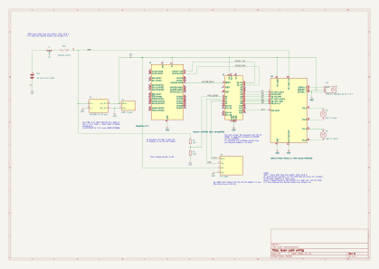

# Rover camera for watching the biped — design

Nov 22, 2026 · @Tom Whipple

## Summary

A floor rover built almost entirely from the old kit: the Pi 4 runs the camera and a small command-line tool, the aLaMode runs the motors and pan servo, and Claude drives it with short move, pan and snapshot commands sent over SSH from your laptop. The priority is getting it running quickly, so there is no custom service and no custom power board.

The Pi never touches the motors directly. It sends one-line commands over serial to the aLaMode, which enforces time limits and a stand-off distance on its own. If the Pi, Wi-Fi or Claude stalls, the rover stops.

Choices and assumptions, two of them mine because the question went unanswered:

- **Surface:** floor only (your answer, read as option 1). No cliff sensors.
- **Power:** one of the biped's 3S packs (OVONIC 4200 mAh, XT60), through an XT60 pigtail with an inline 5 A fuse, one 5 V buck for the Pi, and the motors on pack voltage (revised 2026-11-24, see Power). Code lives in a new repo, rover-cam, not in the robot repo.
- **Control (assumed):** staged. Manual step-and-look driving first, tag-based auto-follow later.
- **Budget (assumed):** small buys of about $50 are fine.

Video stays on your network. Any frame Claude looks at is sent to Anthropic, same as with the PTZ camera plan.

## Parts on hand

Identified from your three photos. Only the camera still needs a look before wiring.

| Part | What it is | Job on the rover |
| --- | --- | --- |
| Raspberry Pi 4 (with heatsinks) | Linux computer, Wi-Fi, camera port | Camera, HTTP service, serial link to the aLaMode |
| WyoLum aLaMode | Arduino-Uno-compatible ATmega328P board that plugs onto the Pi's first 26 GPIO pins; has an RTC and microSD | Real-time motor and servo control, safety limits |
| Adafruit Motor Shield v1 | Two L293D drivers behind a 74HC595 latch, two servo headers | Drives the two wheel motors |
| Round two-deck chassis | Two yellow TT gearmotors, caster, toggle switch | The base |
| Parallax servo on the metal bracket | **Standard type, per its label** | Camera pan |
| Raspberry Pi Camera Board (element14 box) | **Check:** most likely the original 5 MP v1 with a 15-pin ribbon | The eye |
| OVONIC 3S 4200 mAh LiPo, XT60 | 11.1 V nominal, 12.6 V full, from the biped's stock | Power |
| Power-lite board | The biped's protection and distribution board | Not used: there is no spare BMS, so a fused pigtail replaces it |

## Architecture

Three boards stack on the top deck, and every command passes down the same chain.

Physical stack, bottom to top:

1. Lower deck: gearmotors, the 3S pack, fuse, switch and the 5 V buck converter.
2. Upper deck: Pi 4 on standoffs.
3. aLaMode on the Pi's GPIO pins 1 to 26.
4. Motor shield on the aLaMode's Arduino headers.
5. Mast at the front: pan servo on the metal bracket, camera on the servo horn, about 28 cm above the floor and level, which frames the 56 cm biped from 1 m away.

Command path:

1. Claude runs `ssh` in a shell on your laptop.
2. The command crosses your Wi-Fi to the Pi over SSH.
3. The rover tool on the Pi writes a one-line command to the aLaMode over the Pi's UART.
4. The aLaMode checks limits, then drives the shield and servo.
5. For a look, the tool grabs one JPEG from the camera and streams it back.

Each look-and-move cycle takes Claude several seconds, so this is step-and-look driving. For anything fast, such as a fall, the Pi records video locally and Claude reviews frames afterwards.

## Wiring and pin map

The schematic is the KiCad project `hardware/rover-cam.kicad_sch`. Regenerate the image with `kicad-cli sch export svg -o /tmp/svg hardware/rover-cam.kicad_sch && cp /tmp/svg/rover-cam.svg docs/wiring.svg` (PDF: `kicad-cli sch export pdf -o docs/wiring.pdf hardware/rover-cam.kicad_sch`).

The wheel motors go on the shield's M3 and M4 terminals, which keeps D11 free and leaves only one pin shared with the aLaMode's SPI lines.

| Signal | Pin | Notes |
| --- | --- | --- |
| Pi to aLaMode serial | Pi header 8 and 10 to ATmega D0 and D1 | 115200 baud; also used to flash firmware. The aLaMode level-shifts these lines through its U6 translator (datasheet p. 6), enabled by the U6\_OE jumper |
| aLaMode reset | Pi header 12 | Lets the Pi reset the ATmega for flashing |
| aLaMode power | 5V-LINK jumper ON | aLaMode logic runs from the Pi's 5 V |
| Shield latch | D4, D7, D8, D12 | D12 is also SPI MISO, so the aLaMode microSD stays unused and Pi SPI stays off |
| Left and right motor PWM | D5, D6 (M3, M4) | Speed capped in firmware |
| Pan servo | Shield SERVO 1 header (D9) | The header's power is the shield's 5 V logic rail (the Pi's 5 V), not EXT\_PWR |
| Pack voltage | A0 | 10 k over 3.3 k divider from VBAT (pack after fuse and switch), 3.1 V at a full pack |
| Front ultrasonic sensor (on hand) | A1 trigger, A2 echo | Fixed to the chassis, facing forward. A 3-pin Ping))) uses A1 alone. Power it from the 5 V row of the aLaMode's A3–A5 header; the A0–A2 row is 3.3 V |
| Camera | Pi CSI port | Ribbon exits from under the stack to the mast |

On the shield, pull the PWR jumper so motor power comes only from the EXT\_PWR terminals, which connect straight to VBAT.

Sources: the [aLaMode v1 datasheet](https://www.electrokit.com/upload/product/41011/41011667/AlaMode_V1datasheet.pdf) for the header pins and 5V-LINK, and [shieldlist.org](https://www.shieldlist.org/adafruit/motor) for the shield pins. Shieldlist does not say which shield revision it covers, so the pins were checked against the AFMotor library source (latch D4/D7/D8/D12, M3 PWM D6, M4 PWM D5) and the [Adafruit FAQ](https://learn.adafruit.com/adafruit-motor-shield/faq) ("Digital pin 9: Servo #1 control").

## Power

One 3S pack feeds everything through an XT60 pigtail, an inline 5 A fuse and the chassis switch. After the switch (VBAT, 10.5–12.6 V), one 5 V buck powers the Pi and the motors run straight from VBAT. This replaces the first draft's two Pololu regulators (about $45) with one $10 buck, and keeps the 3S packs already on hand.

The first draft's 6 V motor rail was a mistake, not just a cost. The L293D drops about 2.6 V at 0.6 A (1.4 V high side plus 1.2 V low side, typical; [TI SLRS008D](https://www.ti.com/lit/ds/slrs008d/slrs008d.pdf)), so 6 V in leaves the motors about 3.4 V, and about 2 V on average under the firmware's PWM cap of 150/255.

From the switch:

- **5 V 3 A buck, [Adafruit UBEC #1385](https://www.adafruit.com/product/1385)** (6–16 V in, 5 V ±5 %, 3 A continuous): to the Pi 4's USB-C port through a USB-A-to-C cable with the A end cut off. The aLaMode, the shield's logic and the pan servo take 5 V from the Pi through the stacked headers.
- **Shield EXT\_PWR, PWR jumper removed:** straight from VBAT. The shield runs motors on 4.5–25 V ([Adafruit](https://www.adafruit.com/product/81)).
- **A0 divider:** 10 k over 3.3 k, 3.1 V at a full pack.

Run the EXT\_PWR GND and the buck's IN− straight to the pack negative, in wire as heavy as the positive side. Otherwise motor current returns through the header pins and the USB cable's ground. On the cut USB cable, red is +5 V and black is GND; meter it before plugging it into the Pi.

**Motor voltage.** With the PWM cap and the L293D drop, the motors average about 150/255 × (12.6 − 2.6) ≈ 5.9 V on a full pack and 4.6 V at the 10.5 V cutoff, inside the TT motors' 3–6 V rating ([Adafruit 3777](https://www.adafruit.com/product/3777)). No firmware change is needed. A TT motor stalls at 1.5 A at 6 V (same source), more than the L293D's 0.6 A rating whichever supply is used, so moves stay at 2 s or less and the chip's thermal shutdown is the backstop.

**Fuse.** 5 A, not 3 A: a stalled motor is about 4 Ω (6 V / 1.5 A), so on 10 V pulses two stalled motors could trip a 3 A fuse during an ordinary bump. 5 A still protects the wiring from a pack short. Use 20 AWG or heavier from the pack to the switch.

**Servo.** The shield's servo header runs on its 5 V logic rail, not the motor supply ([Adafruit FAQ](https://learn.adafruit.com/adafruit-motor-shield/faq)). The Parallax servo takes 4–6 V and "can briefly increase to 500 mA or more" ([Parallax guide](https://mm.digikey.com/Volume0/opasdata/d220001/medias/docus/5728/900-00005_Guide.pdf)). That shares the UBEC's 3 A with the Pi's typical 600 mA ([Raspberry Pi docs](https://www.raspberrypi.com/documentation/computers/raspberry-pi.html)). If the Pi reports under-voltage (below 4.63 V) when the servo moves, give the servo its own 5 V supply.

**Load.** The Pi's typical 0.6 A at 5 V is about 0.3 A from the pack at 90 % buck efficiency, so a 4200 mAh pack idles for over 10 hours. Driving and camera use shorten that; it has not been measured.

Battery alternatives considered:

- **2S LiPo** (about $12 for 2200 mAh with XT60, [Altitude Hobbies](https://altitudehobbies.com/products/roaring-top-2200mah-2s-7-4v-25c-lipo-battery)): gives the motors 4.8–5.8 V after the L293D with no PWM cap needed, but still needs the 5 V buck, so it costs more than using the 3S packs on hand.
- **USB power bank** with 5 V 3 A out: the motors would get about 2.4 V after the L293D, and A0 could no longer see the pack. Not a fit.

**Under-voltage is not protected.** With no BMS, nothing disconnects a low pack. The aLaMode reads pack voltage on A0 and refuses to drive below 10.5 V, and the status command reports it, but the switch has to be turned off by hand. A left-on rover will ruin the pack.

## Software

Two small programs: an Arduino sketch on the aLaMode and `rover`, a C++ command-line tool on the Pi that Claude runs over SSH. Both live in the new `rover-cam` repo.

Firmware serial commands, one per line:

| Command | Meaning |
| --- | --- |
| `M left right ms` | Run the motors at -255 to 255 for at most 2000 ms, then stop |
| `P deg` | Pan the camera to 0 to 180 degrees |
| `S` | Stop now |
| `?` | Report pack millivolts and front range in cm |

Pi commands:

| Command | Does |
| --- | --- |
| `rover snap` | One JPEG on stdout |
| `rover move L R MS` | Timed move |
| `rover pan DEG` | Pan |
| `rover stop` | Stop |
| `rover status` | Pack voltage and range |

There is no HTTP service. SSH already authenticates, runs commands and returns pictures, so nothing extra has to be written, secured or kept running. Pi-side logic is C++ from the start, with no dependencies beyond the standard library, so the later stages extend this tool. Snapshots shell out to the stock `rpicam-still` for now.

How Claude uses it: it runs `ssh rover rover snap > look.jpg`, looks at the picture and decides the next move. The hardware session on your laptop can do this directly. A phone chat linked to the laptop can only if its shell is allowed to reach LAN hosts.

Stage 2, later: an AprilTag on the biped's torso. A loop on the Pi keeps the tag centred, pan first and wheels second, and holds the stand-off distance. Add a `rover record` command then, so falls are captured at full frame rate. That loop is the core logic and stays in C++.

## Self-driving and SLAM (secondary goal)

These come after the camera works, but the rover needs two things it does not have: a way to measure its own motion and a sensor that can see walls.

1. **Remote-driven camera.** The build above. No new parts.
2. **Tag follow.** Keeps the biped in frame. No new parts.
3. **Self-driving with obstacle avoidance.** Needs wheel encoders, because the TT gearmotors have none. Slotted-disc encoders for these motors cost about $5 a pair and go on D2 and D3, the ATmega's two interrupt pins, both free in this pin map. The ultrasonic sensor is enough for stopping short of things.
4. **SLAM.** Needs a 2D lidar on the top deck, about $70 to $100, on a Pi USB port. The ultrasonic sensor is too coarse to map with, and camera-only SLAM on a Pi 4 with this camera is heavy and fragile. A BNO085 like the biped's would steady the heading if one is spare.

Choices made now to keep that path open:

- The mast sits at the front edge, so the centre of the top deck stays clear for a lidar.
- D2 and D3 stay unused until the encoders arrive.
- The Pi code is C++, the language of the usual lidar SLAM stack (ROS 2 with slam\_toolbox). The serial code in `rover` becomes the base driver there.

One decision is deferred: the Pi's OS. Raspberry Pi OS is quickest for the camera today, while ROS 2 installs most easily on Ubuntu. Start on Raspberry Pi OS and revisit at stage 4. Part prices and the ROS 2 note are from memory, not looked up.

## Safety

The limits sit in the aLaMode firmware, so nothing sent from the Pi can override them.

- **Timed moves only.** Every move ends by itself within 2 seconds. A stalled Pi, dropped Wi-Fi or slow Claude means a stopped rover.
- **Speed cap.** PWM is limited to about 60 percent.
- **Stand-off.** Forward motion is refused when the front sensor reads under 80 cm. The biped is 56 cm to the top of its head (robot repo, DESIGN.md), so a fall cannot reach the rover.
- **No self-driving in stage 1.** The rover moves only on an explicit command.
- **Low pack.** No driving below 10.5 V.
- **Hard off.** The main switch cuts everything.

## Buy list

About $15, or $22 with both optional items. The UBEC price was checked on 2026-11-24; the rest are approximate, from memory.

| Item | Why | Approx. |
| --- | --- | --- |
| [Adafruit UBEC 5 V 3 A](https://www.adafruit.com/product/1385) (#1385) | Pi 4 supply from the pack | $9.95 |
| Inline blade fuse holder with a 5 A fuse | Short-circuit protection for the pack | $3 |
| XT60 male pigtail | Pack to fuse, if not already on hand | $2 |
| USB-A-to-C cable to cut, 10 k and 3.3 k resistors | Pi power lead, A0 divider; likely on hand | — |
| 26-pin stacking header | Only if the aLaMode fouls the Pi 4's heatsinks or jacks | $3 |
| 30 cm camera ribbon | Only if the stock ribbon will not reach the mast | $4 |

## Build order

Each step has one check before moving on.

1. **Pi and camera alone.** Flash the OS, connect the camera. Check: `rpicam-still -o test.jpg` gives a picture.
2. **aLaMode on the Pi, no shield.** Enable the UART, turn the serial console off, flash a blink sketch. Check: the D13 LED blinks.
3. **Power.** Pack, fuse, switch and the 5 V buck, nothing connected downstream. Check: 4.75 to 5.25 V at the buck output and pack voltage at the EXT\_PWR leads, on a meter.
4. **Shield and motors, wheels off the ground.** Check: `M 120 120 1000` turns both wheels forward for one second, then stops.
5. **Servo.** Check: `P 90` centres it.
6. **The rover tool.** Check: a snapshot and a move from the laptop with `ssh`.
7. **Claude in the loop.** Check: Claude pulls a snapshot through the laptop and describes the room.
8. **Distance sensor and stand-off.** Check: the rover refuses to drive at a wall inside 80 cm.
9. **Floor test with the biped powered off**, then on.
10. **Stage 2:** tag tracking and recording.

## Open questions

Settled on 2026-11-24: one 5 V buck and the motors on pack voltage, 5 A fuse. Settled on 2026-11-22: fused pigtail and no power-lite board; the servo is a standard one; stand-off is 80 cm from the biped's 56 cm height; SSH and no HTTP service; Pi-side code in C++; self-driving and SLAM are a secondary goal.

- [ ] Which camera is in the box, and is its ribbon there?
- [ ] Which ultrasonic sensors do you have: 4-pin HC-SR04 or 3-pin Parallax Ping)))?
- [ ] Does the aLaMode seat on the Pi 4 with the heatsinks fitted?
- [ ] What does the aLaMode's U6\_OE jumper do? The datasheet does not say; check the KiCad files in WyoLum's repo before enabling Pi SPI.
- [ ] Is the chassis toggle switch rated for 5 A DC?
- [ ] Which Claude session will drive the rover, and can it reach the Pi by SSH?
